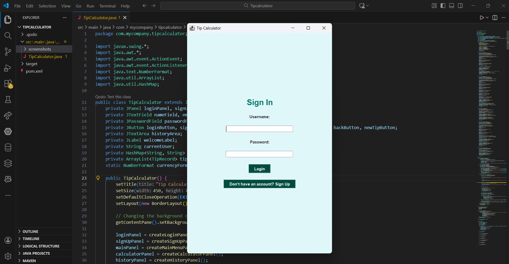
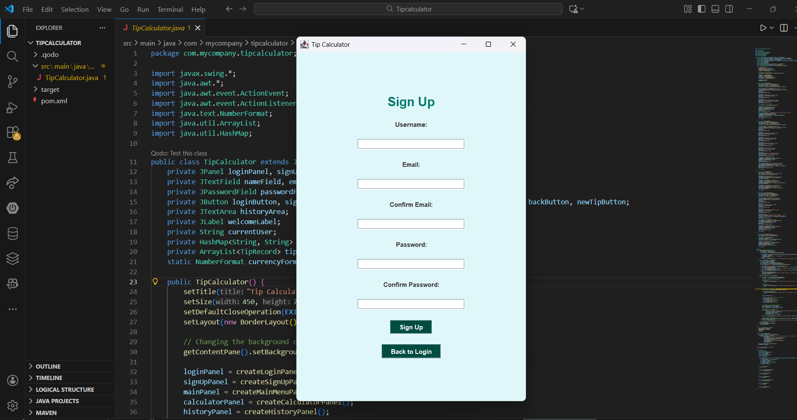
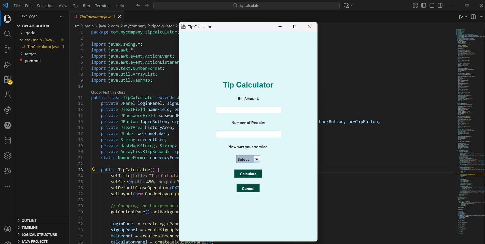
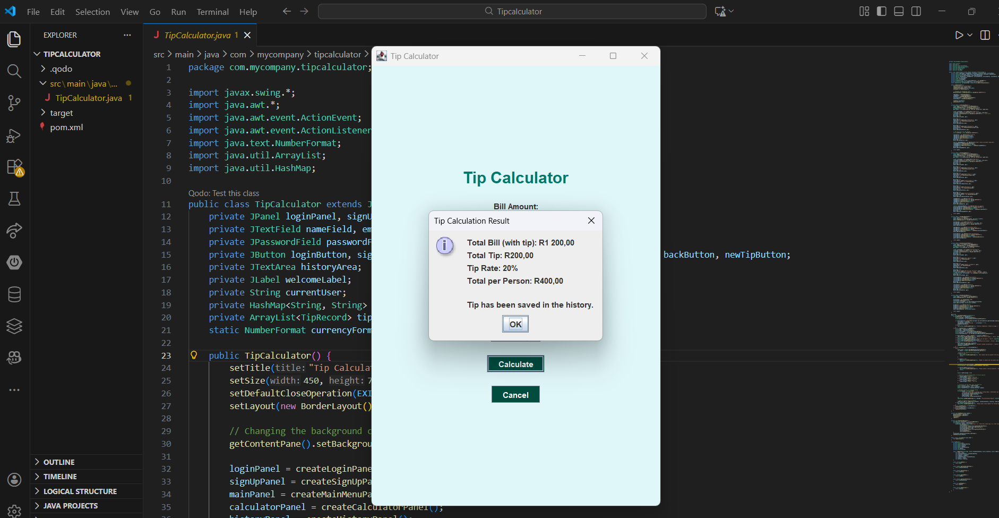
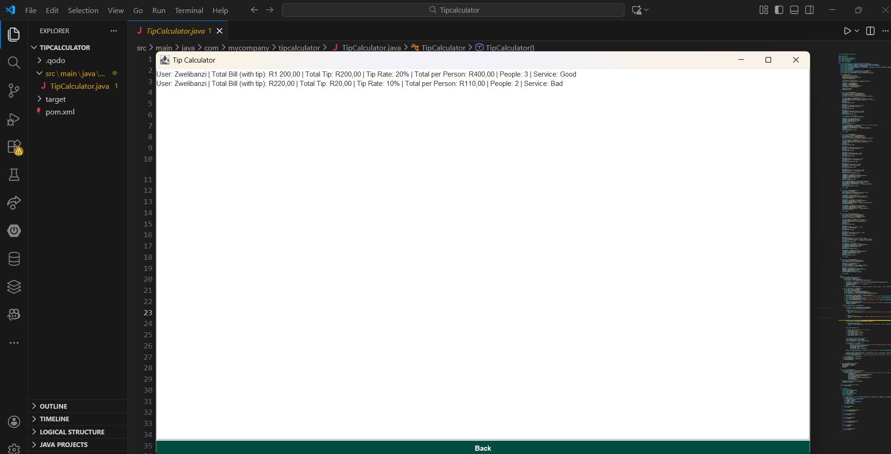

```md
# 🧮 Tip Calculator Desktop Application (Java Swing)

A Java Swing–based desktop application that enables users to log in, calculate restaurant tips based on service quality, split bills among multiple people, and view a history of previous calculations.

The application focuses on clear user flows, reliable input validation, and structured data handling, implemented using core Java principles and event-driven GUI design.

---

## 📑 Table of Contents

* Motivation & Problem Statement
* Project Overview
* Features
* System Architecture
* Data Structures & Design
* User Interface Design
* Screenshots
* Technologies Used
* Getting Started
* Usage
* Validation & Error Handling
* Project Structure
* Design Considerations
* Future Improvements
* License
* Contact

---

## 🎯 Motivation & Problem Statement

Calculating tips and splitting bills is a common task, yet many simple calculators lack input validation, service-based tipping logic, and the ability to track past calculations.

This project was built to provide a reliable desktop solution that handles these scenarios while applying fundamental software engineering concepts such as object-oriented design, structured data storage, and clear separation between user interface and business logic.

---

## 📖 Project Overview

The Tip Calculator Desktop Application allows users to:

* Register and authenticate within the application
* Calculate tips dynamically based on service quality
* Split a bill fairly between multiple people
* Store and review previous tip calculations
* Navigate seamlessly between different application screens

The system is designed to mirror realistic user interactions in a desktop environment.

---

## ✨ Features

### 🔐 User Authentication

* User registration with username, email confirmation, and password confirmation
* Login validation using in-memory credential storage
* Personalized welcome message after successful login

---

### 🧮 Tip Calculation

* User input for bill amount and number of people
* Service quality selection:
  * Good (20%)
  * Average (15%)
  * Bad (10%)
* Automatic calculation of:
  * Total tip
  * Total bill including tip
  * Amount per person

---

### 🗂️ Tip History

* Automatic storage of each calculation
* History records include:
  * User name
  * Total bill with tip
  * Tip amount
  * Tip percentage
  * Number of people
  * Service quality
* Scrollable history view for improved readability

---

## 🧠 System Architecture

```

User Interaction
↓
Event Handling (ActionListener)
↓
Input Validation
↓
Tip Calculation Logic
↓
Data Storage (HashMap / ArrayList)
↓
UI Update

````

This structure keeps application logic organized and easy to follow.

---

## 🧱 Data Structures & Design

| Component                 | Purpose                                                   |
| ------------------------- | --------------------------------------------------------- |
| `HashMap<String, String>` | Stores user credentials                                   |
| `ArrayList<TipRecord>`    | Stores tip calculation history                            |
| `TipRecord`               | Encapsulates all data related to a single tip calculation |

The choice of data structures reflects the required access patterns and simplicity of the application.

---

## 🎨 User Interface Design

The user interface is built using **:contentReference[oaicite:0]{index=0}** with a consistent color palette and layout structure.

Design considerations include:

* Clear visual hierarchy
* Readable typography
* Consistent spacing and alignment
* Smooth transitions between screens

Layouts such as `GridBagLayout`, `BorderLayout`, and `BoxLayout` are used where appropriate.

---

## 🖼️ Screenshots

Create a folder named `screenshots` in the project root and place your images inside it.

```text
screenshots/
├── login.png
├── signup.png
├── calculator.png
└── history.png
````

### Login Screen



### Sign Up Screen



### Tip Calculator





### Tip History



---

## 🛠️ Technologies Used

### Programming Language

* **Java**

### UI Framework

* **Java Swing**
* AWT Event Handling

### Tools

* **VS Code**
* **Git**

---

## 🚀 Getting Started

### Prerequisites

* Java JDK 8 or higher
* Any Java IDE or code editor

### Running the Application

```bash
git clone https://github.com/your-username/tip-calculator.git
cd tip-calculator
```

Run the `TipCalculator.java` file to launch the application.

---

## 🧭 Usage

1. Start the application
2. Create a new user account
3. Log in with your credentials
4. Select **Calculate Tip**
5. Enter bill details and service quality
6. View the calculated results
7. Access **Tip History** to review past calculations

---

## ✅ Validation & Error Handling

The application includes validation to handle:

* Empty input fields
* Invalid numeric values
* Negative or zero bill amounts
* Invalid number of people
* Unselected service quality

User-friendly error messages are displayed when input does not meet requirements.

---

## 📁 Project Structure

```
TipCalculator/
│
├── TipCalculator.java
├── screenshots/
│   ├── login.png
│   ├── signup.png
│   ├── calculator.png
│   └── history.png
└── README.md
```

---

## 📐 Design Considerations

* Clear separation between UI and business logic
* Simple and readable control flow
* Data encapsulation through dedicated classes
* Ease of extension for future enhancements

---

## 🔮 Future Improvements

* Persistent storage using a database
* Password hashing for improved security
* Exportable tip history reports
* UI enhancements and theming options
* Migration to JavaFX or a web-based interface

---

## 📄 License

This project is available for educational and personal use.

---
